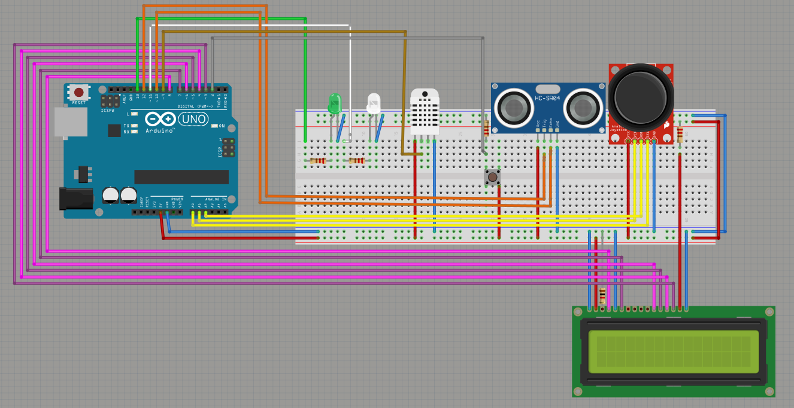
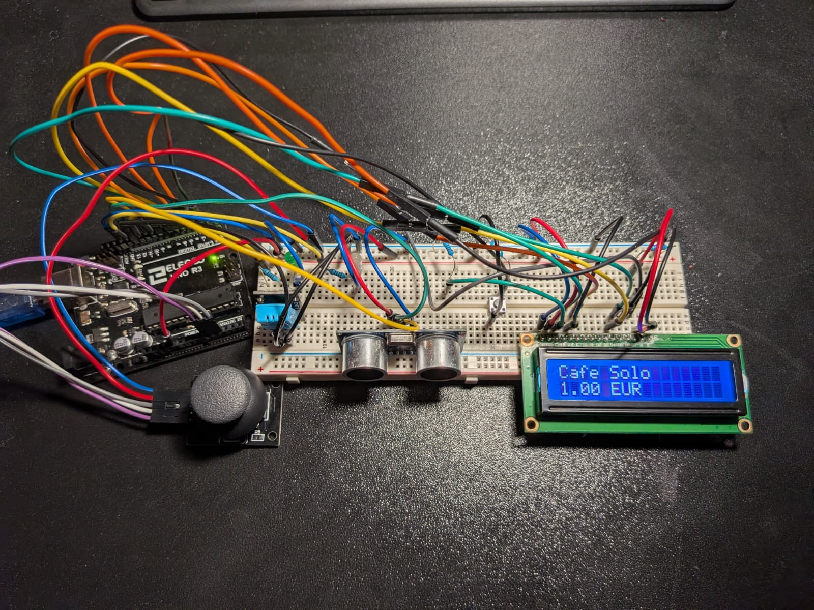
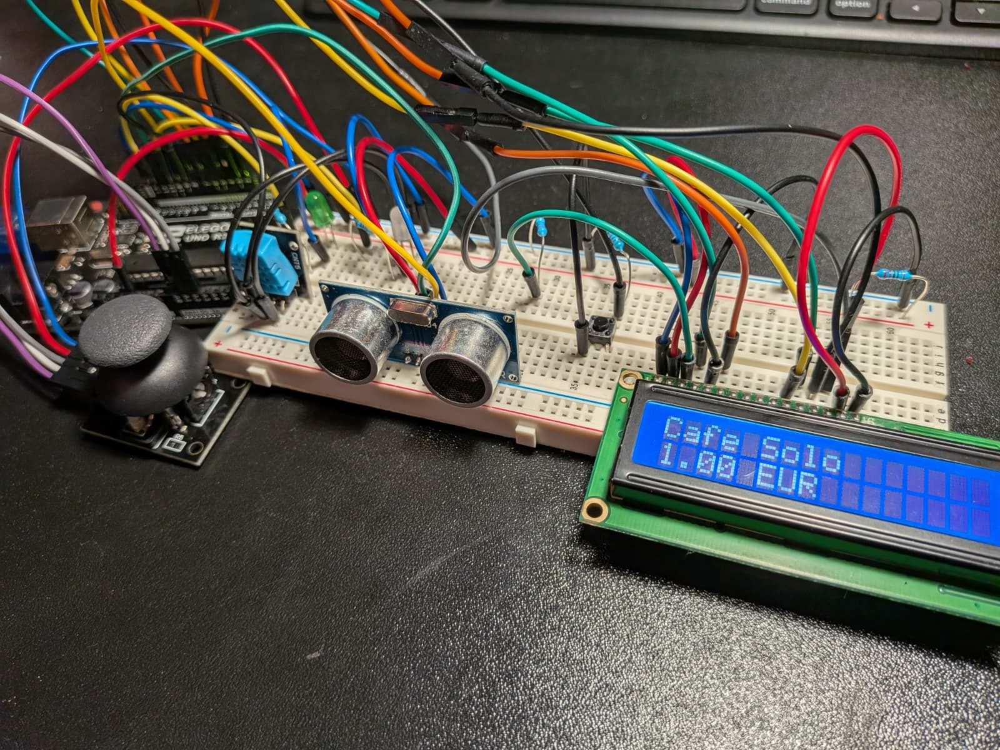

<nav class="ide-tabs" aria-label="Índice">
  <a href="#arquitectura" class="active">MaquinaExpendedora.ino</a>
  <a href="#pines">Pines.ino</a>
  <a href="#imagenes">Montaje.ino</a>
  <a href="#interrupciones">Interrupciones.ino</a>
  <a href="#threads">Threads.ino</a>
  <a href="#watchdog">Watchdog.ino</a>
  <a href="#resultado">Video.ino</a>
</nav>

# Arquitectura {#arquitectura}
El sistema se implementa como una única máquina de estados finita (FSM) con 10 estados, dividiendo cada fase en un estado para que cada uno tenga una única responsabilidad.

| Estado | Apartado | Qué hace | Transición |
|---|---|---|---|
| `ARRANQUE` | 3.1 | Parpadeo del LED1 (3 veces, periodo de 1 s) y mensaje "CARGANDO..." | Tras los 3 parpadeos → `SERVICIO` |
| `SERVICIO` | 3.2.a | Mide la distancia y muestra "ESPERANDO CLIENTE" | Distancia < 1 m → `BIENVENIDO` |
| `BIENVENIDO` | 3.2.b | Muestra la temperatura y la humedad durante 5 s | A los 5 s → `CATALOG` |
| `CATALOG` | 3.2.b | Navegación por los productos con el joystick (arriba/abajo) | Pulsar joystick → `PEDIDO` |
| `PEDIDO` | 3.2.b | "Preparando Café..." durante 4–8 s aleatorios; el LED2 aumenta su brillo (PWM) según el progreso | Fin del tiempo → `RETIRAR` |
| `RETIRAR` | 3.2.b | Muestra "RETIRE BEBIDA" durante 3 s | A los 3 s → `SERVICIO` |
| `ADMIN` | 3.3.a / 3.3.b | Entrada al modo admin: enciende LED1 y LED2 y muestra el menú | Inmediato → `INTERACT_ADMIN` |
| `INTERACT_ADMIN` | 3.3.c | Navegación por el menú de administración | Pulsar joystick → `SHOW_CASES` |
| `SHOW_CASES` | 3.3.c (i–iv) | Muestra la opción elegida: temperatura, distancia, contador o listado de productos | Izquierda → `INTERACT_ADMIN` · Pulsar (en precios) → `EDIT_PRICES` |
| `EDIT_PRICES` | 3.3.c.iv | Modifica el precio en tramos de 0,05 € | Pulsar → guardar y `SHOW_CASES` · Izquierda → descartar y `SHOW_CASES` |

**Transiciones globales (botón externo, por interrupción):**
- Pulsación de **2–3 s** durante el servicio (`BIENVENIDO` a `RETIRAR`) → cancela y vuelve a `SERVICIO`.
- Pulsación de **≥ 5 s** → desde cualquier estado entra en `ADMIN`; si ya estás en admin, sale a `SERVICIO`.

# Pines Utilizados {#pines}

- **Pin 2 → botón externo.** En el Arduino UNO solo los pines 2 y 3 admiten interrupciones externas (`attachInterrupt`), y el 3 lo usa el LCD.
- **Pin 11 → LED2.** Necesita PWM para ir aumentando el brillo durante la preparación. Los pines 9 y 10 también tienen PWM, pero dependen del Timer1, que uso con TimerOne para el contador, así que elegí el 11, que va con otro temporizador.
- **Pines 9 y 10 → DHT11 y Echo del ultrasonido.** Como los uso como entradas digitales normales, que TimerOne ocupe su temporizador no les afecta.
- **A1 y A2 → ejes del joystick.** Son entradas analógicas, necesarias para leer la posición (0–1023).
- **A0 → pulsador del joystick.** Lo uso como entrada digital con `INPUT_PULLUP`, así que pulsado = `LOW`.

# Imágenes del Circuito {#imagenes}

# Recursos Utilizados
## Interrupciones {#interrupciones}

### Interrupción por hardware (botón externo)

Para el botón externo he utilizado una interrupción por hardware. Lo he conectado al **pin 2**, porque en el Arduino UNO solo los pines 2 y 3 permiten interrupciones externas, y el 3 ya lo estaba usando para el LCD. El botón está montado con una resistencia *pull-down*, así que cuando está pulsado leo `HIGH` y cuando está suelto, `LOW`.

He configurado la interrupción en modo `CHANGE`, para que la función `ISR_boton()` salte tanto al pulsar como al soltar. Cuando se pulsa, guardo el instante en el que ha ocurrido. Cuando se suelta, calculo cuánto tiempo ha estado pulsado y activo un *flag* (`hay_pulsacion`) para avisar al programa principal. Además, ignoro cualquier cambio que llegue a menos de 100 ms del anterior, para evitar los rebotes típicos de los botones mecánicos.

Mi ISR solo mide el tiempo, sin cambiar el estado ni escribir en la pantalla. Toda la lógica la he dejado en el `loop()`. Allí, cuando veo que hay una pulsación nueva, copio la duración con las interrupciones.

### Interrupción por Software:
Para el contador del modo Admin he usado la librería **TimerOne**, que configura el *Timer1* del microcontrolador para generar una interrupción cada cierto tiempo. En mi caso, cada segundo:

    Timer1.initialize(1000000);           // 1 000 000 µs = 1 s
    Timer1.attachInterrupt(contarSegundo);

La ISR `contarSegundo()` solo hace una cosa: sumar 1 a la variable `segundos`, que está declarada como `volatile` porque la comparten la ISR y el resto del programa. Para mostrarla, el hilo del contador copia su valor con las interrupciones desactivadas un instante y lo escribe en el LCD.

Así separo las dos tareas: **el temporizador cuenta** (de forma exacta, sin depender de lo que esté haciendo el `loop`) y **el thread solo muestra** el valor. Aunque el programa estuviera ocupado, el contador no se retrasa.

## Threads {#threads}

Para las tareas que se repiten cada cierto tiempo he usado la librería **ArduinoThread**. Cada tarea es un `Thread` con su intervalo y la función que ejecuta (`onRun`), y todos se añaden a un `ThreadController`. En cada vuelta del `loop()` llamo a `controller.run()`, que ejecuta solo los hilos a los que ya les toca.

No son hilos en paralelo de verdad (el Arduino tiene un solo núcleo), sino **multitarea cooperativa**: cada hilo hace su trabajo rápido y devuelve el control. Cada uno lee su sensor y pinta directamente en el LCD.

| Thread | Intervalo | Activo en |
|---|---|---|
| `hiloArranque` | 500 ms | `ARRANQUE` (parpadeo del LED1) |
| `hiloPresencia` | 100 ms | `SERVICIO` (detección de cliente) |
| `hiloTemperatura` | 300 ms | `BIENVENIDO` y admin → Ver temperatura |
| `hiloDistancia` | 100 ms | admin → Ver distancia |
| `hiloContador` | 300 ms | admin → Ver contador |

Para no gastar recursos, cada hilo **solo está activo en el estado que lo necesita**. Antes de `controller.run()`, la función `actualizarThreads()` activa o desactiva cada uno con su atributo `enabled` según el estado actual. Ese orden es importante: si se ejecutaran antes de actualizarse, un hilo del estado anterior podría ejecutarse una vez de más y, por ejemplo, sacarme del modo Admin.

Los temporizadores de una sola vez (los 5 s de bienvenida o los 3 s de "RETIRE BEBIDA") no los he hecho con threads, sino con `millis()`, porque no son tareas periódicas.

## WatchDog {#watchdog}

Como mecanismo de seguridad he activado el **watchdog** del microcontrolador (`avr/wdt.h`). Funciona como una cuenta atrás: si el programa no la reinicia a tiempo, la placa se resetea sola. Así, si el sistema se queda bloqueado por algún fallo, se recupera automáticamente.

En el `setup()` lo configuro con un tiempo de **2 segundos** (`wdt_enable(WDTO_2S)`), y al principio de cada vuelta del `loop()` lo refresco con `wdt_reset()`. Como el programa no usa `delay()` y ninguna tarea tarda tanto, en funcionamiento normal nunca llega a saltar. Solo actuaría si algo se quedara colgado de verdad.

# Resultado Final {#resultado}

<video src="assets/video/demo.mp4" controls width="100%"></video>